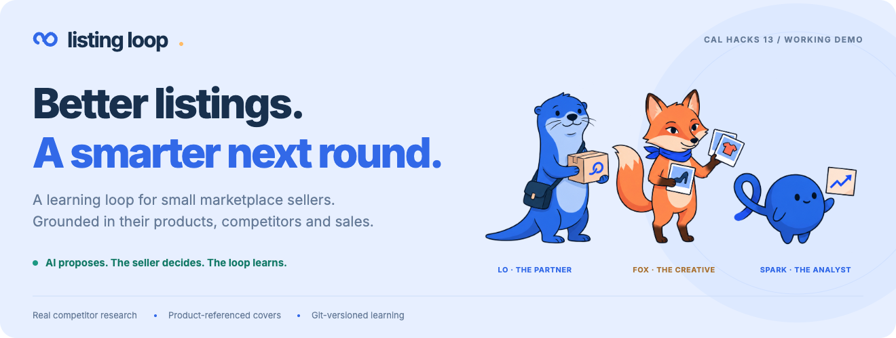
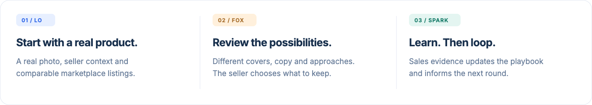
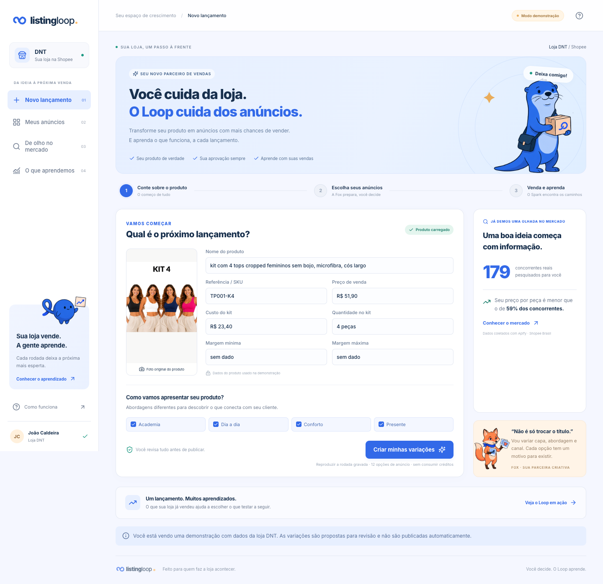

# Listing Loop

**Generate product-grounded listings, review the options, and use sales evidence to make the next launch smarter.**

Built around the workflow of DNT, a Brazilian fashion seller on Shopee. Listing Loop brings competitor research, listing production and a versioned learning loop into one interface. The seller reviews every proposal; nothing is published automatically.

[Run the demo](#run-the-demo) · [Inspect the evidence](#evidence-you-can-inspect) · [See how it works](#how-it-works)



## Why this exists

For a small seller, launching a product means researching competitors, preparing images, writing copy and choosing what to test. After launch, a high click-through rate still does not explain which approach earns more profit.

Listing Loop keeps the choices and their evidence together. It explores different approaches, covers and acquisition channels, then uses the store's history to update recommendations for the next round.

## Run the demo

The default is **replay mode**: existing results, real product photos and saved research. No API keys or Factory sessions are needed.

```sh
cd app
npm ci
npm run dev
```

Open **http://localhost:3000**. Start with the product, open the generated listings, approve a few, then visit **O que aprendemos** to compare the rounds. The product interface is in Brazilian Portuguese for its target sellers.

<details>
<summary>See the product interface</summary>



</details>

## Evidence you can inspect

| Artifact | What it contains |
| --- | --- |
| [Competitor research](runs/r1/intel.json) | 179 unique Shopee competitors, comparable prices per piece, kit mix, keywords and source references. |
| [Round 1](runs/r1/variants) | 12 generated listings, with copy, product-referenced covers, fixed experiment axes and rationales. |
| [Round 1 statistics](runs/r1/stats.json) | A demonstration base: 3 partially real listings with estimated funnel data, plus 12 simulated listings. |
| [Round 2 statistics](runs/r2/stats.json) | 14 real DNT listings from the Seller Center, covering September 25–October 24, 2026. |
| [Learning changes](runs/r2/memory-diff.json) | Real data reverses earlier recommendations: academia and solo_linha become priorities; casual loses priority. |
| [Round 2 plan](runs/r2/plan.json) | 12 planned options informed by learning; [4 generated examples](runs/r2/variants) are available. |
| [Store playbook](memory/playbook.json) | Rules with evidence, uncertainty and confidence, versioned in Git. |

**Limits of the evidence:** round 2 profit is before ad spend, which is missing from the export. All 14 real listings use ads, so this round cannot compare acquisition channels. The historical comparisons are observational; uncertainty and inconclusive results remain visible.

## How it works

1. **Research.** Apify supplies real Shopee listings. Code filters comparables and calculates price-per-piece, kit and keyword patterns.
2. **Plan.** Thompson sampling balances reusing promising options with exploring uncertain ones. A constraint prevents repeated approach/cover pairs.
3. **Produce.** A Factory Droid SDK conductor delegates listing generation to the `listing-producer` custom droid. Zod validates the outputs; code checks cited competitor IDs.
4. **Review.** The seller inspects covers, copy, hypotheses and sources, then approves or leaves options out.
5. **Learn.** Code bootstraps performance by listing. The `performance-analyst` custom droid proposes evidence-backed playbook changes; code validates, applies and commits them. The next plan uses that memory.

The repository contains the outputs of completed runs. Replaying a round does not collect new sales or run a new marketplace experiment.

## Built with

| Tool | Role in the product |
| --- | --- |
| **Claude + Factory Droid SDK** | Conductor, listing production and evidence interpretation through two custom droids. |
| **Apify** | Real marketplace research that grounds the generated listings. |
| **Next.js + React + TypeScript** | Seller interface, replay streaming, review and learning views. |
| **Zod + Git** | Validated file contracts and an auditable history of learning. |

**Lo, Fox and Spark** are the product's guides: partner, creative and analyst. The [README design kit](app/design/readme/README.md) includes editable SVGs, PNG exports and the [Figma mascot workspace](https://www.figma.com/design/XDf8Er4HW0v29ziTEv80Qw).

## Repository map

```text
app/                 Seller interface, replay API and front-end documentation
src/                 Planning, generation, research, statistics and memory
.factory/droids/     listing-producer and performance-analyst instructions
data/                Product reference, competitor data and store history
runs/r1/ · runs/r2/   Saved plans, listings, covers, statistics and learning diffs
memory/              Current playbook; previous versions live in Git
```

## Development

Front-end checks:

```sh
cd app
npm run build
npm run test:e2e
```

Browser tests use the locally installed Chrome; set `CHROME_PATH` for another installation. See the [front-end guide](app/README.md) for replay packaging and deployment limits.

For engine development, run `npm ci` at the repository root and `npm run typecheck`. Paid generation and learning are separate CLI workflows; their configuration is in [`.env.example`](.env.example), [`src/config.ts`](src/config.ts) and [the droid definitions](.factory/droids). The demo interface keeps paid generation disabled by default.

Built for **Cal Hacks 13**, from a real small seller's workflow.
